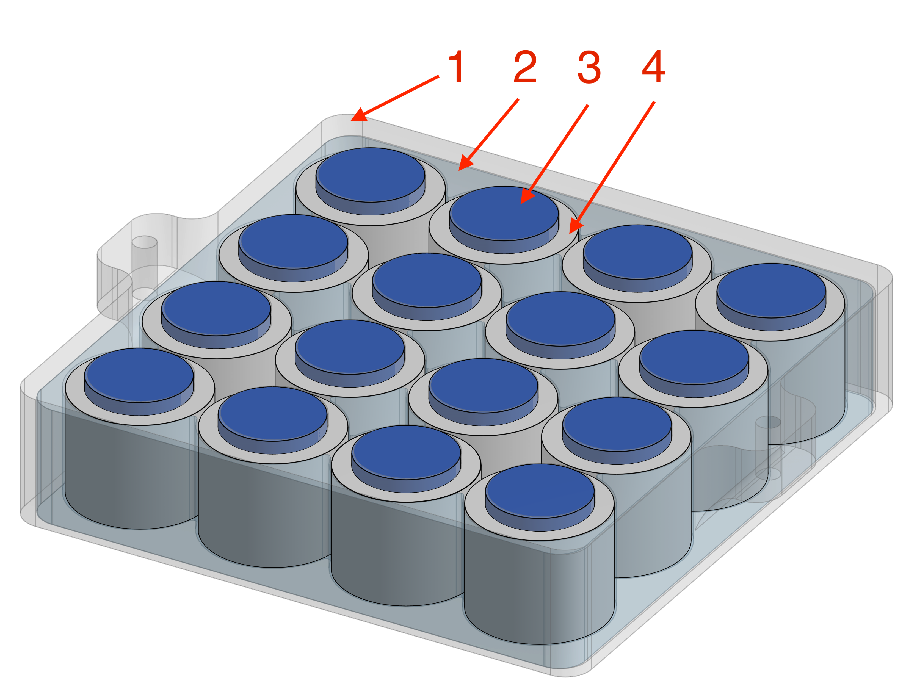
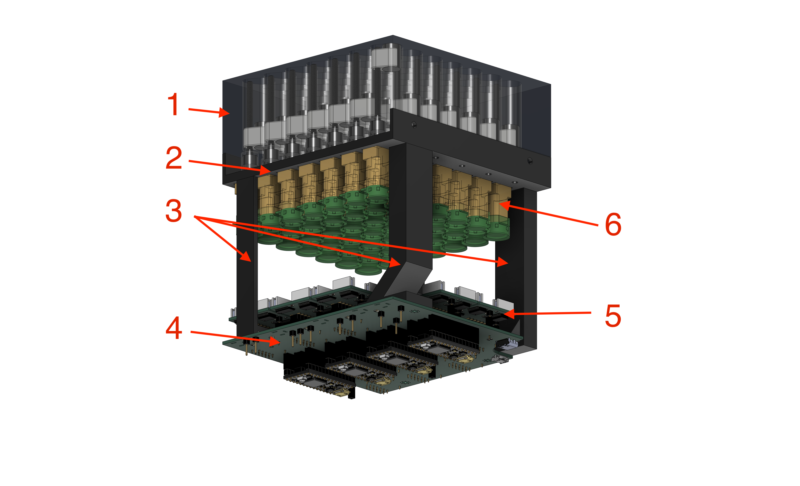
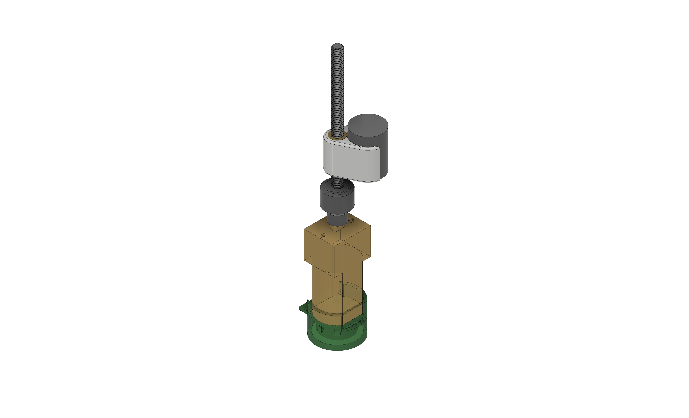
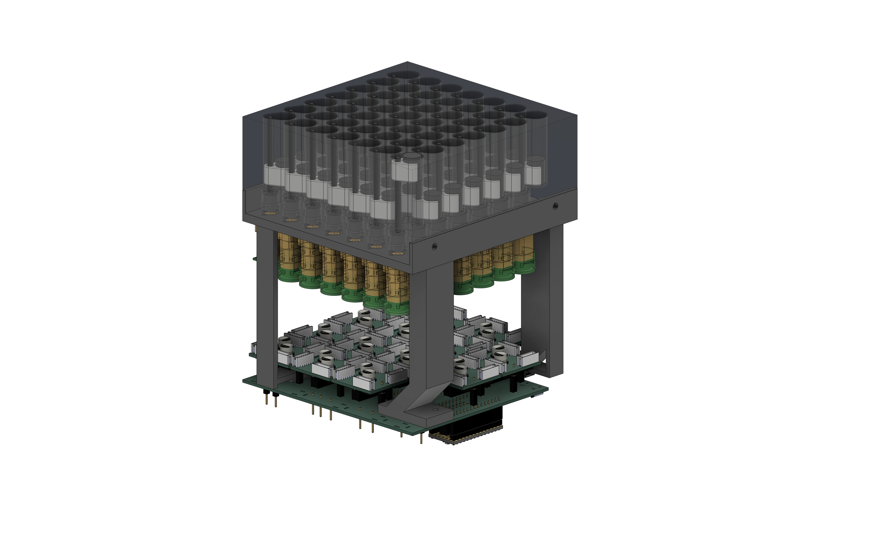

**Hardware design, fabrication files, and software for Granular IO.**

[Project Website](https://www.axlab.cs.uchicago.edu/projects/granular-io) | [Paper](https://doi.org/10.1145/3830398.3830589) | [Video](https://youtu.be/jblO1pQyjmk)

GranularIO explores the interactivity of granular materials through externally actuated magnetic particles. This repo contains the GUI, Arduino code, mechanical and electrical design files of the prototype device.

> **Status:** Fabrication and design files for the EM and LAPM hardware are available in this repository. Documentation is still being expanded; complete assembly, wiring, and software setup instructions are not yet provided here.

## Repository structure

```text
GranularIO/
├── ArduinoCode/
│   ├── EM/                         # Firmware for the EM platform
│   └── LAPM/                       # Firmware for the LAPM platform
├── GUI/
│   └── GranularIO/                 # Graphical user interface
├── Hardware/
│   ├── EM/                         # Electromagnet array fabrication files
│   │   ├── 1_EM_Cover.stl
│   │   ├── 2_EM_Hub.stl
│   │   ├── 3_MetalDisk.step
│   │   ├── EM_Assembly.png
│   │   └── EM_Bottom.png
│   ├── LAPM/                       # LAPM fabrication files (detailed below)
│   │   ├── 1_Rail_Array.stl
│   │   ├── 2_Motor_Hub.stl
│   │   ├── 3_Supporting_Beams/
│   │   │   ├── 3_Supporting_Beam_a.stl
│   │   │   ├── 3_Supporting_Beam_b.stl
│   │   │   ├── 3_Supporting_Beam_c.stl
│   │   │   └── 3_Supporting_Beam_d.stl
│   │   ├── 4_MotherBoard_PCB/
│   │   ├── 5_MotorDriver_PCB/
│   │   ├── 6_Pin/
│   │   │   ├── 6_1_Magnet_Holder.stl
│   │   │   ├── 6_2_Screw_Connector.stl
│   │   │   └── 6_3_Encoder_Cap.stl
│   │   └── PCB Kicad Files/        # Additional KiCad-related files
│   └── Other 3D Print Files/       # Other printable components
├── images/                          # README illustrations
├── LICENSE
└── README.md
```

## EM hardware assembly

The EM platform uses an array of electromagnets. The annotated CAD rendering identifies the fabricated components and purchased electromagnets used in the assembly.



*Figure 1. EM assembly with numbered components. Parts 1–3 correspond to design files in `Hardware/EM/`; part 4 is a purchased electromagnet.*

| No. | File or component (inside `Hardware/EM/`) | Description | Fabrication / sourcing |
| --- | --- | --- | --- |
| **1** | `1_EM_Cover.stl` | Cover for the electromagnet array. | 3D printing |
| **2** | `2_EM_Hub.stl` | Hub that positions and supports the electromagnets within the assembly. | 3D printing |
| **3** | `3_MetalDisk.step` | Metal disk component mounted above the electromagnet units. | **Waterjet cut from sheet metal** using the supplied CAD geometry. |
| **4** | Electromagnet (purchased) | Off-the-shelf electromagnet used in the array. | **Purchased online**; no fabrication file is supplied for this component. |

Additional reference images are included in `Hardware/EM/`: `EM_Assembly.png` and [`EM_Bottom.png`](Hardware/EM/EM_Bottom.png).

The STEP file for part 3 provides the metal disk geometry, but material grade and thickness should be confirmed before ordering waterjet-cut parts. The electromagnet specifications and supplier should likewise be verified before purchasing replacements.

## LAPM hardware assembly

The LAPM platform contains an array of motor-driven magnetic actuator pins. The numbered callouts below correspond to the files and folders in `Hardware/LAPM/`.



*Figure 2. LAPM assembly and its six main component groups.*

### Mechanical components

| No. | File or folder (inside `Hardware/LAPM/`) | Description |
| --- | --- | --- |
| **1** | `1_Rail_Array.stl` | Rail array that guides the sliding motion of the magnets. |
| **2** | `2_Motor_Hub.stl` | Motor-mounting structure. Motors are fastened to the hub with screws; the hub also attaches to the rail array (1) and supporting beams (3). |
| **3** | `3_Supporting_Beams/` | Four separate support beams (`a`, `b`, `c`, `d`) connecting the motor hub (2) to the lower electronics assembly. |
| **4** | `4_MotherBoard_PCB/` | Fabrication files, documentation, and 3D model for the motherboard PCB. |
| **5** | `5_MotorDriver_PCB/` | Fabrication and assembly files for the motor-driver PCB. |
| **6** | `6_Pin/` | 3D-printable components used in an individual actuator pin. |

### Individual actuator pin



*Figure 3. Individual motor-driven actuator pin.*

The `Hardware/LAPM/6_Pin/` folder includes:

| File | Purpose |
| --- | --- |
| `6_1_Magnet_Holder.stl` | Holds the magnet at the moving end of the actuator. |
| `6_2_Screw_Connector.stl` | Connects the screw-driven mechanism to the moving pin assembly. |
| `6_3_Encoder_Cap.stl` | Cap for the motor encoder assembly. |

### PCB fabrication files

**Motherboard** — `Hardware/LAPM/4_MotherBoard_PCB/`

| File | Contents |
| --- | --- |
| `MotherBoard_Gerber.zip` | Gerber manufacturing package for the motherboard. |
| `MotherBoard_3D_Model.step` | 3D model of the PCB assembly. |
| `MotherBoard_Schematic.pdf` | Circuit schematic. |
| `MotherBoard_PCB_F.pdf` | Front-side PCB drawing. |
| `MotherBoard_PCB_B.pdf` | Back-side PCB drawing. |
| `readme.md` | Additional motherboard-specific documentation. |

**Motor-driver board** — `Hardware/LAPM/5_MotorDriver_PCB/`

| File | Contents |
| --- | --- |
| `MotorDriverGerber.zip` | Gerber manufacturing package for the motor-driver board. |
| `MotorDriver_3D_Model.step` | 3D model of the PCB assembly. |
| `MotorDriver_Schematic.pdf` | Circuit schematic. |
| `MotorDriver_PCB_F.pdf` | Front-side PCB drawing. |
| `MotorDriver_PCB_B.pdf` | Back-side PCB drawing. |
| `MotorDriver_BOM.csv` | Component bill of materials. |
| `MotorDriver_pos.csv` | Component placement/position data. |

A separate `Hardware/LAPM/PCB Kicad Files/` folder is also included for additional PCB design files. See the files in that folder for their supported formats and revisions.

### Complete assembly



*Figure 4. Assembled LAPM motor array, support frame, and electronics.*

## Fabrication notes

- The `.stl` files are intended for 3D-printing the mechanical components. The EM `3_MetalDisk.step` is for waterjet cutting metal sheet; the PCB `.step` files provide 3D board models.
- Gerber archives are intended for PCB fabrication; schematic PDFs and front/back drawings are provided for reference. For the motor-driver PCB, a BOM and placement file are also included.
- Motors, magnets, electromagnets, screws, and other off-the-shelf components must be sourced separately; they are not included in the printable STL files.
- The files are provided as design and fabrication resources, **not** as a complete tested assembly guide. Check dimensions, interfaces, manufacturing requirements, and file revisions before ordering parts.

## Publication

Chi Wang, Clara Cui, Alan Pham, Justice T Andersen, Tucker Rae-Grant, and Ken Nakagaki. **Granular I/O: Enabling Bi-directional Malleable Interaction for Actuated TUIs with Magnetic Particles.** *ACM Symposium on User Interface Software and Technology (UIST 2026).* [DOI: 10.1145/3830398.3830589](https://doi.org/10.1145/3830398.3830589).

## License

See the [LICENSE](LICENSE) file for usage and redistribution terms.
